<h3>System Profile</h3>

<h3>Mission Briefing</h3>

> **Goal:** Build a solid foundation in web application security, network penetration testing, and exploit development through hands-on practice, documentation, and continuous learning. Open to collaborations on CTFs or security research.

<h3>Tech Stack &amp; Tools</h3>

  

<h3>GitHub Activity</h3>

<h3>Featured Projects</h3>

| Project | Description |
| :--- | :--- |
| **[Metasploitable2 Pentest](https://github.com/gowdavikas253-png)** | Penetration testing and exploitation of the Metasploitable2 virtual machine. |
| **[Burp Suite Pentesting Labs](https://github.com/gowdavikas253-png)** | Documentation of Burp Suite practice, DVWA exercises, and PortSwigger Web Security Academy labs. |

<i>"The best way to learn security is to break things (ethically)."</i>

